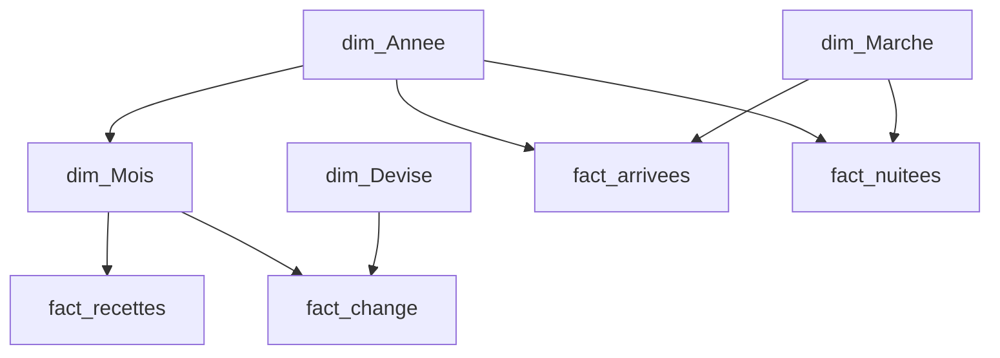
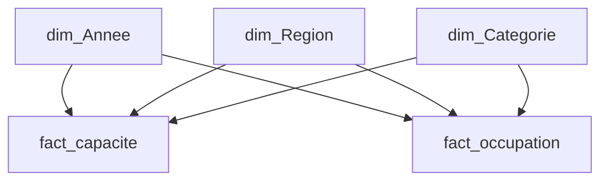

# Modele dimensionnel

Le DWH est une constellation de tables de faits autour de dimensions partagees.
Une ligne de fait correspond a une observation au grain annonce. Les rapports ne joignent
jamais directement deux faits pour additionner leurs lignes.

`dim_Source` reference tous les faits pour leur provenance. Les fleches ci-dessus representent
le filtrage unidirectionnel dimension vers fait. Le schema SQL exact, avec cles primaires,
cles etrangeres et contraintes d'unicite, est dans `outputs/schema.sql`.

| Fait | Grain unique | Mesures | Lignes du jeu fourni |
|---|---|---|---:|
| fact_recettes | Mois | Recettes_MDT | 96 |
| fact_change | Mois x devise | Taux_TND | 192 |
| fact_arrivees | Annee x marche | Arrivees | 168 |
| fact_nuitees | Annee x marche/groupe resident | Nuitees | 132 |
| fact_arrivees_saison | Annee x marche x saison | Arrivees | 258 |
| fact_capacite | Annee x region x categorie | Lits, etablissements | 270 |
| fact_occupation | Annee x region x categorie | Taux_pct nullable | 270 |
| fact_investissements | Annee x gouvernorat | Hebergement, animation, total en milliers TND | 24 |
| fact_sites | Annee x site/musee | Visiteurs | 305 |
| fact_agences | Annee x region x licence | Agences | 108 |
| fact_restaurants | Annee x region x classe | Restaurants | 80 |
| fact_duree_marche | Annee x marche x indicateur | Duree ou coefficient | 405 |
| fact_previsions | Mois x modele x cible | Valeur_MDT, bornes, date d'entrainement | 0 |

Dimensions : annee, mois, marche, region, categorie d'hebergement, gouvernorat,
site, devise, saison, licence, classe de restaurant, indicateur et source.

`MoisKey` est un entier AAAAMM. `AnneeKey` est l'annee. Les autres dimensions emploient
des cles techniques entieres. Une reconstruction remplace le DWH complet : ces cles ne sont
pas promises stables entre deux jeux de donnees differents. Ne pas conserver une table externe
avec ces anciennes cles lors d'un changement de sources.

`ref_controles_source` stocke les totaux publies pour comparaison, sans les additionner aux faits.
`etl_execution` conserve la derniere reconstruction dans la base ; les rapports de test sont
distincts. `SourceKey`, `SourceFeuille` et `SourceLigne` donnent l'origine de chaque observation.

Les cles temporelles mensuelles et annuelles sont distinctes. Un montant annuel n'est jamais
repete douze fois. Les taux et les durees sont non additifs. Le coefficient de mobilite est un ratio,
sans unite ; il n'est pas mesure en jours meme si le classeur maitre le suggere.

Pour S5, etendre le calendrier aux mois futurs **avant** de charger `fact_previsions`.
L'ETL actuel reconstruit aussi cette table vide : sauvegarder/exporter les futures previsions
avant une reconstruction, ou ajouter leur recharge dans la version S5.

La validation de ce modele par les encadrants doit etre obtenue par le groupe.
